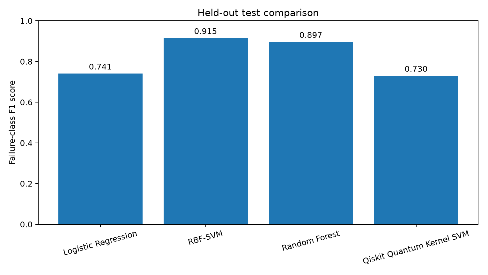
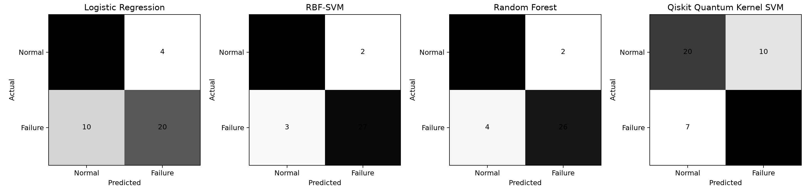
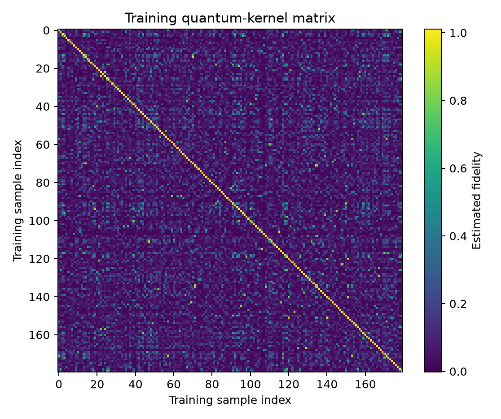

# Quantum Kernel Learning for Machine-Failure Classification

**A preliminary Quantum Machine Learning experiment using Qiskit and the UCI AI4I 2020 Predictive Maintenance Dataset.**

[](https://www.python.org/)
[](https://www.ibm.com/quantum/qiskit)
[]()

## 1. Overview

This project investigates how a quantum-kernel-based classifier compares with classical machine-learning models on a predictive-maintenance classification task.

A four-qubit quantum feature map is used to construct a fidelity-based quantum kernel. The resulting kernel matrices are supplied to a Support Vector Machine (SVM).

The quantum model is evaluated against three classical approaches:

- Logistic Regression
- RBF Support Vector Machine
- Random Forest

The objective is not to claim quantum advantage, but to implement a reproducible baseline experiment and examine the practical performance of a quantum-kernel workflow.

## 2. Research Question

How does a four-feature, four-qubit ZZFeatureMap quantum-kernel SVM compare with classical classifiers for machine-failure classification on a controlled subset of the AI4I 2020 dataset?

## 3. Dataset

**UCI AI4I 2020 Predictive Maintenance Dataset**

- Repository: [UCI Machine Learning Repository](https://archive.ics.uci.edu/dataset/601/ai4i+2020+predictive+maintenance+dataset)
- Dataset ID: 601
- DOI: [10.24432/C5HS5C](https://doi.org/10.24432/C5HS5C)
- Original records loaded: 10,000
- Failure records: 339

The dataset is synthetic, as identified by UCI. It should not be interpreted as a collection of direct factory measurements.

### Selected features

Four numerical features were used:

1. Temperature difference (process temperature − air temperature)
2. Rotational speed (rpm)
3. Torque (Nm)
4. Tool wear (min)

**Target:** Machine failure (Normal / Failure)

Identifiers, product type, and individual failure-mode labels were excluded from the selected feature set.

### Sampling strategy

A balanced case-control subset was created:

| Item | Count |
|---|---:|
| Normal samples | 120 |
| Failure samples | 120 |
| Total subset | 240 |
| Training samples | 180 |
| Held-out test samples | 60 |

The train/test split used random seed 42.

**Important:** The balanced sample does not preserve the original failure prevalence of approximately 3.39%. Accuracy and precision from this experiment are therefore not deployment estimates.

## 4. Quantum Methodology

The quantum implementation uses:

- Four qubits
- Qiskit ZZFeatureMap
- Two feature-map repetitions
- Linear entanglement
- FidelityQuantumKernel
- ComputeUncompute fidelity estimation
- StatevectorSampler with 1,024 shots
- Scikit-learn SVC using a precomputed kernel matrix

### Workflow

1. Load the AI4I 2020 dataset.
2. Select the four numerical features and binary target.
3. Create a balanced case-control sample.
4. Split the samples into training and test sets.
5. Preprocess and scale the features.
6. Construct the quantum feature map.
7. Evaluate the training and test-to-training quantum kernel matrices.
8. Train the quantum-kernel SVM.
9. Train classical baseline models.
10. Evaluate and compare held-out test predictions.

The quantum calculations were performed using a local simulator. No physical quantum processor was used.

## 5. Experimental Results

The following results were obtained from the completed experiment.

### Model comparison

| Model | Accuracy | Failure Precision | Failure Recall | Failure F1 |
|---|---:|---:|---:|---:|
| Logistic Regression | 0.767 | 0.833 | 0.667 | 0.741 |
| RBF-SVM | 0.917 | 0.931 | 0.900 | 0.915 |
| Random Forest | 0.900 | 0.929 | 0.867 | 0.897 |
| Quantum Kernel SVM | 0.717 | 0.697 | 0.767 | 0.730 |

### Additional metrics

| Model | ROC-AUC | Average Precision |
|---|---:|---:|
| Logistic Regression | 0.897 | 0.904 |
| RBF-SVM | 0.938 | 0.964 |
| Random Forest | 0.947 | 0.964 |
| Quantum Kernel SVM | 0.746 | 0.711 |

### Interpretation

The classical RBF-SVM achieved the highest failure-class F1 score of 0.915.

The quantum-kernel SVM achieved a failure-class F1 score of 0.730. Although it successfully completed the classification workflow, it did not outperform the classical baselines in this experiment.

This result illustrates that using a quantum feature map does not automatically improve predictive performance. Dataset characteristics, feature representation, sampling, measurement cost, and model selection all matter.

## 6. Visual Results

### Held-out model comparison



### Confusion matrices



### Training quantum-kernel matrix



## 7. Installation and Execution

### Requirements

- Python 3.13
- Qiskit
- Qiskit Machine Learning
- NumPy
- Pandas
- Scikit-learn
- Matplotlib
- ucimlrepo

### Setup on Windows PowerShell

Clone the repository:

```powershell
git clone https://github.com/tiru-venkatesh/quantum-kernel-machine-failure.git

cd quantum-kernel-machine-failure
```

Create and activate a virtual environment:

```powershell
py -3.13 -m venv .venv

.\.venv\Scripts\Activate.ps1
```

Install dependencies:

```powershell
python -m pip install --upgrade pip

pip install -r requirements.txt
```

Run a quick experiment:

```powershell
python run_experiment.py --per-class 30 --shots 256 --reps 1 --output results_quick
```

Run the recorded experiment configuration:

```powershell
python run_experiment.py --per-class 120 --shots 1024 --reps 2 --output results
```

The dataset is retrieved through the UCI Machine Learning Repository interface, so an internet connection is required for the initial download.

## 8. Repository Structure

```text
quantum-kernel-machine-failure/
│
├── run_experiment.py
├── requirements.txt
├── README.md
│
├── START_HERE.txt
├── START_QML_WINDOWS.bat
├── RUN_FULL_EXPERIMENT.bat
│
└── results/
    ├── README.md
    ├── model_metrics.csv
    ├── classification_reports.txt
    ├── confusion_matrices.png
    ├── model_comparison.png
    ├── quantum_kernel_matrix.png
    ├── feature_map_circuit.txt
    ├── run_metadata.json
    ├── run_summary.txt
    ├── case_control_sample.csv
    ├── test_predictions.csv
    └── zz_feature_map.qpy
```

## 9. Reproducibility and Limitations

This is a preliminary simulation-based experiment. Its findings should be interpreted within the following limitations:

- The AI4I 2020 dataset is synthetic.
- The experiment uses a balanced subset rather than the original class distribution.
- The evaluation contains only 60 held-out test samples.
- Quantum-kernel evaluation introduces substantial computational overhead.
- A local statevector simulator was used instead of physical quantum hardware.
- The experiment does not demonstrate quantum advantage or a practical industrial deployment benefit.

Further investigation should include larger evaluation samples, repeated stratified splits, hyperparameter tuning, feature-map ablations, shot-sensitivity analysis, and comparisons with additional classical kernels.

## 10. Key Learning Outcomes

Through this implementation, I explored:

- How classical data can be encoded into quantum feature spaces.
- How ZZFeatureMap circuits generate quantum representations.
- How fidelity-based quantum kernels can be used with classical SVMs.
- How quantum and classical models can be compared through held-out evaluation.
- Why computational cost and classical baselines matter when evaluating QML claims.

## 11. References

1. UCI Machine Learning Repository — AI4I 2020 Predictive Maintenance Dataset. https://doi.org/10.24432/C5HS5C
2. Havlíček et al. (2019). *Supervised learning with quantum-enhanced feature spaces*. Nature. https://doi.org/10.1038/s41586-019-0980-2
3. Schuld and Killoran (2019). *Quantum machine learning in feature Hilbert spaces*. Physical Review Letters. https://doi.org/10.1103/PhysRevLett.122.040504
4. Qiskit Documentation. https://docs.quantum.ibm.com/

---

**Author:** Tiru Venkatesh Musirana

**GitHub:** [tiru-venkatesh](https://github.com/tiru-venkatesh)

**Project:** [Quantum Kernel Learning for Machine-Failure Classification](https://github.com/tiru-venkatesh/quantum-kernel-machine-failure)

*An independent learning and experimentation project. The results are preliminary and are presented for research discussion, not as evidence of quantum advantage.*
